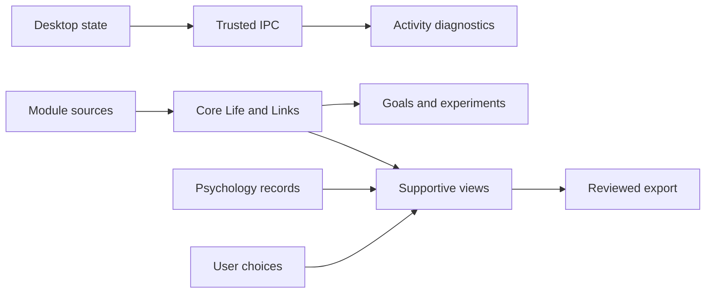

# Requirements

### Актуальный объём: только документация

Последний запрос заменяет прежнее поручение продолжать реализацию. Подготовить подробное дополнение `docs/roadmap.md` и согласованное краткое обновление `README.md`. Не реализовывать диагностику или новые функции, не менять исходники, зависимости, миграции и spec-файлы; не выполнять commit, push или deploy. Уже существующие незавершённые изменения не удалять и не доделывать.

### Что должно появиться в документации

- Разделение проверенного состояния на **Implemented / Partial / Planned / Research**, с условиями доступности и ограничениями вместо обещаний полной готовности.
- Подробный будущий сценарий диагностики телеметрии, с учётом уже начатого кода.
- Две ранее предложенные функции: **цели → вложенные усилия → выбранные результаты** и **личная лаборатория безопасных бытовых экспериментов**.
- Две дополнительные идеи: **«Бережный день»** и **«Подготовка к приёму специалиста»**, спроектированные без давления продуктивностью, с учётом депрессии и тревоги.
- Для каждой идеи: проблема, пользовательский сценарий, минимальная версия, источники данных, предлагаемое размещение в проекте, пример модели данных, этапы будущей реализации, ограничения и признаки готовности.

### Границы

- Новые функции описываются как предложения для последующей разработки; архитектурные эскизы не означают согласованный контракт или существующий API.
- Быстрый ввод, полный Night Butler, мобильное приложение и браслет остаются прежними отдельными пунктами, а не частью этой работы.
- Ни одна идея не требует браслета или нового пассивного сбора чувствительных данных.
- README содержит только краткое описание существующих возможностей и ссылки; подробные спецификации находятся в ROADMAP, без дублирующего TODO-файла.
- Не переносить личную информацию о диагнозах пользователя в публичную документацию. Описывать универсальные требования доступности для людей с низким ресурсом и тревогой.

# Technical Design

### Документационные изменения

- `docs/roadmap.md`: добавить легенду статусов, исправить затронутые завышенные формулировки и разместить пять подробных карточек в существующих разделах Everyday use, Engineering и Across modules; короткие ссылки связывают карточки без повторных описаний.
- `README.md`: отразить банковскую интеграцию, ограниченные рабочие контексты, хронику и опциональную телеметрию; дать ссылку на будущие возможности, не рекламируя их как готовые.
- Сохранить английский язык существующих документов. Привязать статусы к исходникам, не утверждать работоспособность продакшена по одному наличию файлов.

### Проверенная база и ограничения

- `docs/architecture.md`: модули зависят только от core и contracts. Межмодульные предложения должны использовать зарегистрированные источники, а не прямые импорты Activity/Finance/Tasks друг в друга.
- `libs/api/core/src/lib/life/life.service.ts`: `LifeService` получает события дня и сводки периода через `LifeSource`; источники допускают частичный отказ.
- `libs/api/core/src/lib/links/links.service.ts` и `daily-series.ts`: база межмодульных метрик и анализа связей, не доказательство причинности.
- `libs/modules/psychology/api/src/lib/psychology.schema.ts`: события жизни, опросники и настройки напоминаний уже есть; новые сценарии не следует выдавать за уже существующие формы.
- `libs/shared/contracts/src/lib/telemetry-diagnostics.ts`, `libs/web/core/src/lib/realtime/desktop-bridge.ts` и `libs/modules/activity/web/src/lib/workstates/telemetry-diagnostics.component.ts`: диагностика начата. До отдельной проверки всей цепочки обозначать **Partial**, а не завершённую поставку.
- Рабочие контексты не восстанавливают курсор, терминалы и ветку Git автоматически; расширение захватывает активную вкладку. Ввод ограничен поддерживаемыми контролами Visual Studio, терминальные сигналы требуют `Invoke-PdCommand`. Прокрутка — глубина, а не подтверждённое чтение или отслеживание взгляда.
- Ночная хроника в `libs/api/core/src/lib/life/lifelog.job.ts` — отдельная опциональная задача, не полный Night Butler. Отсутствие активности ПК не измеряет сон; соответствующий пункт ROADMAP переименовать в интервалы использования компьютера.

### Диагностика телеметрии — Partial, завершение отложено

**Сценарий:** на `/activity/workstates` видно не только неактивный тумблер, но и причину с безопасным следующим действием.

- Будущая цепочка: фактические состояния `apps/desktop/src/activity/tracker.ts`, `telemetry.ts` и источников → доверенный IPC в `main.ts` → `preload.ts` → необязательный метод DesktopBridge → `digital-consent.component.ts` и карточка диагностики.
- Сохранить имеющийся контракт: устройство/версия, регистрация/согласие, причина остановки сбора, состояние helper-процесса, очередь, время попытки/успешного HTTP-ответа и код ответа. `accepted` не означает подтверждённую запись в БД; состояние относится к текущей сессии.
- Показывать понятные действия для отсутствия регистрации, старого приложения, паузы, приватного окна и ошибки доставки. В браузере объяснять границы возможностей, а не предлагать бесконечно включать трекер.
- Не возвращать токены, заголовки окон, команды, пути или необработанные ошибки. Смена устройства/аккаунта сбрасывает историю; запоздавшие ответы не меняют состояние нового аккаунта.
- Минимальная версия: чтение состояния и ручное обновление, без новых серверных таблиц, автосогласия или обхода privacy gates. Готовность: причины согласуются с треем, старый bridge не ломает страницу, ошибки не оставляют интерфейс заблокированным.

### Цели, усилия и результаты — Planned

**Польза:** видеть, чему хочется уделять внимание, не превращая часы работы в оценку собственной ценности. Отдых и поддержание повседневной жизни допустимы как самостоятельные цели.

- Минимальная версия: цель связывается вручную с проектом/задачами; пользователь выбирает результат и при желании ориентир времени или бюджета. Недельная карточка отделяет результат, наблюдаемую активность и недостающие данные.
- Пример: «Уделить внимание диссертации» → выбранный проект → подтверждённые рабочие интервалы и завершённая глава; не «работал мало — провалил неделю».
- Основа: существующие годовые цели Life, проекты, `LifeService` и источники `LinksService`. Будущая оркестрация в `libs/api/core/src/lib/life/`, UI в `libs/modules/life/web/`; если текущих сводок мало, расширить core-контракт источника привязками сущностей.
- Эскиз: `GoalLink { goalId, sourceModule, entityType, entityId, confirmedByUser }`, `GoalReview { goalId, period, outcomeNote, sourceRefs, coverage }`; все записи принадлежат `userId`. Это предлагаемые модели, не готовые экспорты.
- Не суммировать пересекающиеся интервалы Activity и WakaTime как независимые часы. Показывать неполное покрытие, сохранять ручные исправления и происхождение привязок. Финансовые значения учитывать с явной валютой.
- Будущие этапы: ручные связи и результаты → объяснимые сводки → опциональные AI-предложения связей и одного небольшого изменения, только после подтверждения.
- Готовность: можно исправить/удалить связь, скрыть сравнение с планом, приостановить цель; отключённый модуль и пропущенные данные не создают отрицательный вывод. В первой версии нет рейтинга продуктивности и обязательных уведомлений.

### Личная лаборатория — Planned / исследование методики

**Польза:** проверить безопасный бытовой вопрос по заранее выбранным правилам, а не приписывать причину случайной корреляции.

- Минимальный сценарий: «Комфортнее ли работать первый блок без уведомлений?» → один показатель, например добровольная оценка комфорта → заранее составленные обычные/изменённые дни → спокойная сводка без требования завершить эксперимент.
- Эскиз: `PersonalExperiment { hypothesis, primaryMetricId, schedule, startOn, endOn, status }`, `Observation { experimentId, localDate, condition, value, sourceRef, adherenceNote }`. Изменение правил версионируется, пропуски не превращаются в нули.
- Предлагаемое размещение: orchestration рядом с Life/Links в core, UI в Life, схемы в `libs/shared/contracts`, запросы в `libs/client/core`. Не путать с ML-экспериментами Study.
- Использовать существующие дневные ряды, часовой пояс пользователя и добровольные наблюдения. Заранее учитывать выходные, порядок условий, перенос эффекта между днями и изменения внешних обстоятельств.
- Будущие этапы: ручной протокол и наблюдения → описательные результаты с покрытием/разбросом → после проверки методики необязательное чередование или рандомизация условий и оценка неопределённости. Не обещать универсальный срок или достаточность произвольного количества дней.
- Готовность: корректная остановка/пауза, объяснение «недостаточно данных», история изменения протокола, отсутствие причинных и медицинских заключений. Исключить эксперименты с лекарствами, лишением сна, питанием и самостоятельно назначаемой экспозицией.

### Новая идея: «Бережный день» — Planned

**Польза:** уменьшить количество решений в тяжёлый день, а не добиться выполнения большого списка.

- Пользователь сам включает режим и выбирает не более 1–3 посильных действий из собственной библиотеки: выпить воды, написать близкому, открыть нужный документ. Доступны «не сегодня», «уменьшить шаг», «отдохнуть» без штрафов и объяснений.
- Первая версия — ручная карточка в Psychology и домашний виджет. Обычные задачи остаются доступными; режим не отменяет медицинские или важные системные уведомления и не переписывает сроки автоматически.
- Эскиз: `GentleDayPlan { localDate, selectedActions, reminderPreference }`; настроение и энергия необязательны. Состояния включают паузу и пропуск, не «провал».
- Будущая реализация: `libs/modules/psychology/api/` и `web/`, общие contracts/client, существующие core-механизмы виджетов и уведомлений. Связь с задачей — ссылка или подтверждённое действие через core, не импорт Tasks в Psychology.
- Будущие этапы: личная библиотека и ручной выбор → виджет и необязательное тихое напоминание → только при желании пользователя черновики маленьких шагов от AI, без автоматической оценки состояния.
- Готовность: полный сценарий работает без AI/браслета; нет стриков, XP за самочувствие, красных просрочек, догоняющего списка и усиления напоминаний при молчании. Выход и удаление плана доступны сразу.

### Новая идея: «Подготовка к приёму специалиста» — Planned

**Польза:** не вспоминать всё на приёме и не повторять тяжёлую историю с нуля. Это органайзер личных заметок, а не AI-терапевт или диагностическая система.

- Сценарий: выбрать период и конкретные записи → добавить «что изменилось», вопросы и собственные наблюдения → проверить одностраничную сводку → вручную экспортировать для специалиста.
- Основа: события/опросники Psychology, дневник и медицинские записи только по отдельному выбору. Сначала ручные записи и данные Psychology; межмодульное включение — следующим этапом через owner-scoped core-провайдеры, не прямой доступ к чужим таблицам.
- Эскиз: `AppointmentBrief { period, selectedSourceRefs, questions, personalNotes, draftText, reviewedAt }`. Источник, дата и различие между словами пользователя и AI-черновиком остаются видимыми.
- Предлагаемое размещение: формы/экспорт в `libs/modules/psychology/`, межмодульная сборка через core по примеру `LifeSource`, общие contracts/client. Чувствительный текст — существующие механизмы шифрования, удаления и контроля доступа; скрытый модуль не включается автоматически.
- Будущие этапы: ручная сводка и экспорт → выбор источников с предпросмотром → опциональное AI-сжатие с явным согласием на выбранного провайдера. Финальный документ всегда утверждает пользователь, автоматической отправки нет.
- Готовность: каждое утверждение можно сверить с источником, удалить раздел и получить документ без AI. Не назначать лечение, не менять дозировки, не добавлять диагнозы и не интерпретировать опросник как диагноз.

### Общие ограничения поддерживающих сценариев

- Продукт помогает организовать жизнь и подготовиться к разговору со специалистом, но не заменяет профессиональную помощь и не обещает уменьшить симптомы.
- Напоминания выключены по умолчанию или явно выбираются пользователем; нет наказаний за пропуски, сравнения с другими и бесконечного цикла проверок/заверений.
- Никаких выводов о депрессии, тревоге, сне или риске по скорости печати и времени за ПК. При нехватке данных — нейтральное сообщение, не тревожная оценка.
- Контакт поддержки можно сохранить вручную; это не обещание круглосуточного наблюдения, автоматического обнаружения кризиса или вызова помощи.

### Эскиз будущих связей, не реализация в этой поставке

Диагностика остаётся локальным чтением состояния. Межмодульные сводки используют core-провайдеры; поддерживающие сценарии управляются пользователем. Конкретные новые интерфейсы предстоит согласовать перед реализацией, не вводить их сейчас.

# Documentation Checks

- Проверить Markdown, внутренние ссылки и существование упомянутых текущих файлов; предлагаемые сущности явно помечать как будущие.
- Сопоставить готовность затронутых пунктов с исходниками и ограничениями клиентов; наличие незавершённого компонента не равно выпуску.
- Проверить согласованность README и ROADMAP: один подробный источник описаний, никаких дублей и обещаний уже реализованных новых функций.
- Проверить, что в текущую документационную поставку не попали изменения кода или тестов. Не запускать сборки и тесты ради изменения Markdown; spec-файлы не создавать и не редактировать.

# Delivery Steps

### Step 1: Уточнить состояние продукта и описать будущую диагностику

README и ROADMAP отличают готовые функции от ограничений и незавершённой диагностики.

- В `docs/roadmap.md` добавить статусы, уточнить рабочие контексты, ввод, браузерную телеметрию и ночную хронику; заменить выводы о сне интервалами использования ПК.
- Описать диагностику как Partial с будущей цепочкой tracker → IPC → UI, причинами недоступности, совместимостью и безопасными действиями.
- В `README.md` кратко актуализировать существующие возможности и дать ссылки на детали.
- Проверить соответствие формулировок исходникам; не продолжать уже начатый код диагностики.

### Step 2: Добавить подробные проекты целей и личной лаборатории

ROADMAP содержит два самостоятельных описания будущих функций с минимальной версией и границами.

- Описать связь целей с результатами, ручные привязки, покрытие данных, исключение двойного учёта времени и опциональные недельные обзоры.
- Описать протокол безопасного бытового эксперимента, модели наблюдений, пропуски, паузу, неопределённость и ограничения интерпретации.
- Привязать эскизы к Life/Links, core-провайдерам и общим контрактам, не создавая реализацию или миграции.
- Проверить различие с существующими годовыми целями, анализом «до/после» и ML-экспериментами Study.

### Step 3: Добавить два поддерживающих сценария и их ограничения

ROADMAP описывает «Бережный день» и подготовку к приёму как опциональные будущие возможности.

- Для каждой идеи добавить сценарий, минимальную версию, источники, модели, точки расширения Psychology/core и последовательность будущей разработки.
- Зафиксировать отсутствие стриков/штрафов, скрытой диагностики и медицинских назначений; сохранить ручной контроль, приватность и работу без AI.
- Уточнить источник каждого утверждения в сводках, предпросмотр и ручное подтверждение экспорта.
- Проверить ссылки, статусы и отсутствие дублей; не включать личные медицинские сведения пользователя в документацию.
