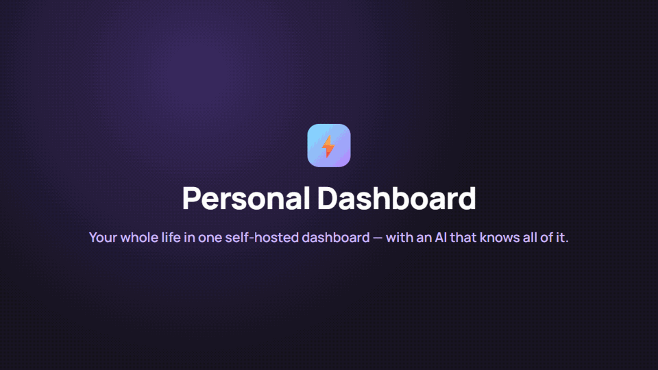

# Personal Dashboard

[](https://github.com/romanrostislavovich/personal-dashboard/actions/workflows/ci.yml)
[](https://github.com/romanrostislavovich/personal-dashboard/actions/workflows/security.yml)
[](https://github.com/romanrostislavovich/personal-dashboard/releases)
[](LICENSE)

**Your whole life in one self-hosted dashboard — with an AI that knows all of it.**

Finance, a diary, tasks, music, games, coding stats, time at the computer, uptime of your sites —
in one place on your own server, with notifications and an assistant in Telegram. Web and an
installable PWA, desktop (Windows / macOS / Linux), Android, a Chrome extension. English and
Russian.



<p align="center">
  <a href="docs/desktop.md"></a>
  <a href="apps/mobile/README.md"></a>
  <a href="apps/extension/README.md"></a>
</p>
<p align="center">
  <a href="#run-it"></a>
  <a href="#highlights"></a>
</p>

> **Status:** a personal project, used every day by its author. It works and is tested, but
> before 1.0 an update may need attention — read the [changelog](CHANGELOG.md) first.

## Highlights

- 🤖 **An AI that can act, not only answer** — ask "how much did I spend on food this month?",
  or tell it in Telegram "remind me tomorrow at 9 to call mum" and it is done. Works with
  DeepSeek, OpenAI, Ollama (fully local) or any OpenAI-compatible API
- 💬 **Telegram as a remote** — voice messages, a photo of a receipt becomes an expense, a bank
  statement PDF becomes transactions, reminders with "Done / +1 hour / Tomorrow" buttons
- 🔔 **One bell everywhere** — every notification in the web, desktop and phone app, read or not
  the same on each; a question ("How was the film?", "A day without alcohol?") is answered once —
  in the bell, in Telegram or right in the phone's notification — and closed everywhere else
- 📖 **Life** — one feed of any day across every section, a daily chronicle with an optional
  story of the day by the AI, a "Wrapped" of the month or the year, questions to your own history
- 🔗 **Sections that know each other** — a project with its hours, commits, money and uptime on
  one page; what goes with your good and bad days, and every daily number against every other
  (Life → Links: correlations of the same and the next day, a graph, what predicts your mood);
  the last commit before a site went down;
  subscriptions you pay for and do not use
- ⚡ **Automations** — "if X, then Y" across sections: a site is down → a task, no diary entry by
  22:00 → a reminder; describe the rule in a sentence and the AI builds it
- ⏱️ **Desktop tracker** (Windows) — which programs and windows ate your day, focus sessions, break
  reminders, daily limits on games, disk cleanup advice from the AI, work contexts you can come
  back to; an optional, off-by-default telemetry with its limits written down
  ([apps/desktop/TELEMETRY.md](apps/desktop/TELEMETRY.md))
- 📱 **The phone as a sensor** (Android) — time in apps, unlocks and late nights, the
  notifications that interrupt you, and a timeline of places like Google Maps': the routes on a
  map, the places with their names (OpenStreetMap, or Google with your key) — a stay with no name
  is asked about ("Where were you?", the places nearby as buttons), on foot or riding;
  the alarm you set, how you meet notifications, the trips abroad; push notifications, offline
  reading (the diary's photos too), "Share" from any app into a task, the diary or the films to
  watch, a home-screen widget; a voice assistant called by a name you choose — the name is heard on
  the phone itself, the answer comes from the same AI, read aloud
- 🎬 **What you watched, by itself** — the browser extension notices a film or a show playing on
  any site (Netflix, a site with its own player), finds it in TMDB, and keeps the hours, the
  episodes and the late nights for Links; ratings, notes and a list to watch
- 🛡️ **Security agent** — watches sign-ins, the server (SSH, firewall, open ports), your computers,
  your phone (its patch, lock, device admins, certificates, apps that install apps) and
  repositories every hour; an AI investigates every morning and tells what to fix
- 🏆 **400+ achievements** across all sections, with XP and a player level
- 🎨 **Comfortable** — Ctrl+K opens any page and searches all your data, themes and accents, a
  home page you arrange yourself, an installable app that opens offline
- 🔒 **Yours** — your server, tokens encrypted, two-factor sign-in, a 30-day trash, an offline
  local copy that syncs both ways with the server

## Sections

|                     |                                                                                                                                                                                                               |
| ------------------- | ------------------------------------------------------------------------------------------------------------------------------------------------------------------------------------------------------------- |
| 💰 **Finance**      | wallets, main currency, budgets, subscriptions, net worth, your bank directly, a wishlist (prices watched, an Excel list for gifts)                                                                           |
| 📔 **Diary**        | Markdown per day, mood, tags, photos, year heatmap, "on this day"                                                                                                                                             |
| 🧠 **Psychology**   | mood patterns, check-ups, life events, a gentle day for hard days, a brief for an appointment                                                                                                                 |
| 🌱 **Habits**       | quitting alcohol, smoking or your own, building the gym or your own: runs, an evening question in Telegram                                                                                                    |
| 🔑 **Passwords**    | a password vault like 1Password: encrypted on the device with a master password, the server keeps only ciphertext                                                                                             |
| 🩺 **Health**       | one medical history across countries: visits, ICD diagnoses, medications, documents; a band through Health Connect and Google Health: the pulse by minutes, sleep stages, HRV, a stress index, body reactions |
| 🎬 **Movies**       | films and shows watched (noticed by the browser extension), ratings and notes (Telegram asks "how was it?" an hour after a film), a list to watch with TMDB search                                            |
| ✅ **Tasks**        | TODO list with short / normal / long-running tasks, repeating tasks, reminders at your local time                                                                                                             |
| 👨‍💻 **Development**  | repositories, stars, releases, npm downloads, contribution streaks, coding time                                                                                                                               |
| 🎧 **Music**        | listening history and tops with genres (Last.fm tags), now playing, your own tracks' stats                                                                                                                    |
| 🎮 **Games**        | Steam library, Dota 2 matches, WoW characters (gear, Mythic+, raids, PvP), Xbox gamerscore and achievements                                                                                                   |
| ⏱️ **Activity**     | time at the computer per program, project and day, Pomodoro, work contexts                                                                                                                                    |
| 📡 **Monitoring**   | uptime every 5 minutes, response time, SSL expiry, down / up alerts                                                                                                                                           |
| 🌤️ **Weather**      | today and the week ahead, what to wear — tuned to how you take the cold                                                                                                                                       |
| 🎂 **Birthdays**    | countdowns and reminders                                                                                                                                                                                      |
| 🚀 **Projects**     | your sites and services — finance, monitoring and AI refer to them                                                                                                                                            |
| 📖 **Life**         | one feed of any day across every section, a daily chronicle, a "Wrapped" of the month or the year, Links between every daily number                                                                           |
| 🤖 **AI**           | a chat over all your data that can act — add, change, remind — with DeepSeek, OpenAI, Ollama or any OpenAI-compatible model                                                                                   |
| ✍️ **Writing**      | spelling and grammar by LanguageTool on your own server and rewrites by the AI — on its page, in the browser extension and the desktop app                                                                    |
| 🛡️ **Security**     | what the security agent found on the dashboard, the server, your computers, the phone and the repositories — the worst first, with what to do                                                                 |
| 🖼️ **Screenshots**  | the desktop app's screenshots, the same folder on every computer and on the server                                                                                                                            |
| 🏆 **Achievements** | 400+ across every section, XP and a player level                                                                                                                                                              |

Every section is a module: hide what you do not use, or [write your own](docs/architecture.md).

## Integrations

- **AI:**
  
  
  
  
- **Messaging:**
  
  
- **Code:**
  
  
  
  
  
- **Music:**
  
  
  
- **Games:**
  
  
  
  
- **Money:**
  
  
  
  
  
- **Places:**
  
  
  
- **Health and films:**
  -4285F4?logo=fitbit&logoColor=white>)
  
  
- **Other:**
  
  

Everything is connected in Settings → Integrations, each with a step-by-step guide —
see [docs/integrations.md](docs/integrations.md).

## Run it

One Docker image (amd64 / arm64), PostgreSQL next to it:

```bash
cp .env.example .env          # set JWT_SECRET, ENCRYPTION_KEY, ADMIN_EMAIL, ADMIN_PASSWORD
docker compose up -d --build  # → http://localhost:3300
```

Sign in with `ADMIN_EMAIL` / `ADMIN_PASSWORD`: the user is created on the first start, database
migrations run by themselves.

**Just looking?** Add `DEMO_MODE=true` to `.env` before the first start: the login page gets a
"Try the demo" button that opens a made-up account with every section filled — nothing to
connect. Its data is made anew every night; do not use it together with your own.

Put HTTPS in front of it (Caddy, Traefik, nginx) and set `PUBLIC_URL`. A ready server setup with
Caddy, daily backups and one-command updates: [docs/deploy.md](docs/deploy.md). Prebuilt image:
`ghcr.io/romanrostislavovich/personal-dashboard`.

Desktop installers are in [Releases](https://github.com/romanrostislavovich/personal-dashboard/releases)
— [docs/desktop.md](docs/desktop.md). The password vault in Chrome (fills, saves, generates):
[apps/extension](apps/extension/README.md). Run a local copy that works offline and syncs with the
server: [docs/sync.md](docs/sync.md). Use your data from Claude Desktop, Claude Code or Cursor
(MCP): [docs/mcp.md](docs/mcp.md).

## Development

```bash
npm install && cp .env.example .env
npm run db:up                 # PostgreSQL in Docker
npm run dev                   # API on :3300 + web on http://localhost:4200
```

Nx · Angular · NestJS · PostgreSQL + Drizzle · pg-boss · grammY · Electron. How it fits together:
[docs/architecture.md](docs/architecture.md) · what is done, partial and next: [docs/roadmap.md](docs/roadmap.md) ·
how to help: [CONTRIBUTING.md](CONTRIBUTING.md) · security reports: [SECURITY.md](SECURITY.md).

## License

[MIT](LICENSE)

Personal Dashboard is an independent project. It is not affiliated with, endorsed or sponsored
by GitHub, GitLab, Atlassian, WakaTime, Valve, Blizzard, Spotify, Last.fm, SoundCloud, OpenAI,
DeepSeek, Telegram, Hetzner or any other service it connects to; their names, trademarks and
APIs belong to their owners. You connect your own accounts with your own keys and are
responsible for following the terms of each service — including the shops whose pages the
wishlist reads once a day to learn a price.
